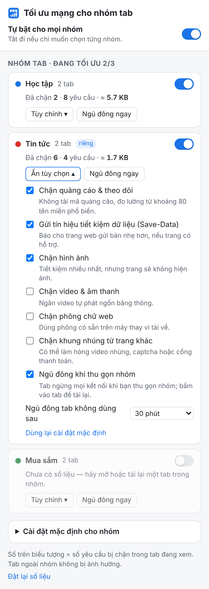

# Tab Group Network Optimizer

Tiện ích (extension) cho **Chrome / Edge** giúp **tiết kiệm mạng chỉ cho những tab nằm trong nhóm tab** (*tab group* — tính năng gom nhiều tab thành một nhóm có tên và màu). Tab không thuộc nhóm nào vẫn tải bình thường, không bị ảnh hưởng.



## Tiện ích làm gì?

| Tính năng | Giải thích dễ hiểu | Mặc định |
|---|---|---|
| Chặn quảng cáo & theo dõi | Không tải mã quảng cáo/đo lường từ ~80 tên miền phổ biến (Google Ads, Criteo, Taboola, Hotjar, Admicro, Eclick…). Ít yêu cầu hơn → trang nhẹ và nhanh hơn. | Bật |
| Tín hiệu tiết kiệm dữ liệu (*Save-Data*) | Gắn thêm dòng `Save-Data: on` vào yêu cầu gửi đi — giống như nói với trang web "hãy gửi bản nhẹ". Trang nào hỗ trợ sẽ gửi ảnh nhỏ hơn. | Bật |
| Chặn hình ảnh | Tiết kiệm nhiều nhất, nhưng trang không có ảnh. | Tắt |
| Chặn video & âm thanh | Ngăn video tự phát ngốn băng thông. | Tắt |
| Chặn phông chữ web | Dùng phông có sẵn trên máy thay vì tải về. | Tắt |
| Chặn khung nhúng từ trang khác (*iframe*) | Chặn phần trang web khác nhúng vào (ví dụ video YouTube nhúng). Có thể làm hỏng captcha, cổng thanh toán. | Tắt |
| Ngủ đông khi thu gọn nhóm | Khi bạn thu gọn (*collapse*) nhóm, các tab trong nhóm được "ngủ đông" (*discard*): trình duyệt đóng mọi kết nối của tab, giải phóng bộ nhớ. Bấm vào tab là tải lại. | Bật |
| Ngủ đông tab không dùng | Tab trong nhóm mà bạn không xem quá N phút (10/30/60/120) sẽ ngủ đông. | 30 phút |

Mỗi nhóm có thể **dùng cài đặt mặc định** hoặc **tùy chỉnh riêng** (ví dụ nhóm "Tin tức" chặn cả ảnh, nhóm "Học tập" thì không). Cài đặt được nhớ theo **tên nhóm**, nên sau khi mở lại trình duyệt vẫn giữ nguyên — vì vậy hãy đặt tên cho nhóm.

Tab ngủ đông được bảo vệ khỏi việc ngủ nhầm nếu: đang được xem, đang phát âm thanh, đã ghim, hoặc là trang nội bộ (`chrome://…`).

## Cài đặt (khoảng 1 phút)

1. Tải thư mục `tab-group-network-optimizer` về máy.
2. Mở `chrome://extensions` (Edge: `edge://extensions`).
3. Bật **Chế độ dành cho nhà phát triển** (*Developer mode*) ở góc trên.
4. Bấm **Tải tiện ích đã giải nén** (*Load unpacked*) → chọn thư mục `tab-group-network-optimizer`.
5. Ghim biểu tượng lên thanh công cụ để tiện bấm.

Cần Chrome/Edge **bản 121 trở lên**.

## Cách dùng

1. Nhấp chuột phải vào một tab → **Thêm thẻ vào nhóm mới** → đặt tên (ví dụ "Học tập").
2. Từ giờ mọi tab trong nhóm được tối ưu tự động. Số trên biểu tượng tiện ích = số yêu cầu đã bị chặn trong tab đang xem.
3. Bấm biểu tượng để xem từng nhóm: số yêu cầu đã chặn, lượng dữ liệu đã tải, bật/tắt nhóm, **Tùy chỉnh** tính năng, hoặc **Ngủ đông ngay**.
4. Muốn chỉ tối ưu vài nhóm: tắt **Tự bật cho mọi nhóm**, rồi bật riêng nhóm cần.

## Cách hoạt động (cho người tò mò)

- Chrome có API **declarativeNetRequest** — bộ luật chặn/sửa yêu cầu mạng do chính trình duyệt thực thi (nhanh, không đọc nội dung trang). Loại luật *session* cho phép giới hạn theo **danh sách mã tab** (`tabIds`).
- Mỗi khi tab vào/ra nhóm, nhóm đổi tên, hoặc bạn đổi cài đặt, tiện ích dựng lại luật với `tabIds` = **chỉ các tab trong nhóm đang được tối ưu**. Tab ngoài nhóm không bao giờ có trong luật → không bị đụng tới.
- Ngủ đông dùng `chrome.tabs.discard()`; số liệu thống kê lấy từ `chrome.webRequest` (chỉ quan sát, không chặn).

## Quyền tiện ích yêu cầu

| Quyền | Để làm gì |
|---|---|
| `tabs`, `tabGroups` | Biết tab nào thuộc nhóm nào. |
| `declarativeNetRequest` + quyền truy cập trang | Chặn yêu cầu và thêm dòng `Save-Data`. |
| `webRequest` | Đếm số yêu cầu/dữ liệu cho từng nhóm (chỉ đếm, không gửi đi đâu). |
| `storage`, `alarms` | Lưu cài đặt; kiểm tra tab nhàn rỗi mỗi phút. |

Tiện ích **không gửi dữ liệu nào ra ngoài**.

## Giới hạn cần biết

- Một tab vừa được kéo vào nhóm sẽ được tối ưu sau khoảng 50 ms; vài yêu cầu đầu tiên trong khoảnh khắc đó có thể lọt qua.
- *Save-Data* chỉ có tác dụng với trang có hỗ trợ.
- Dung lượng "≈ … KB/MB" là **ước tính** theo tiêu đề `Content-Length`; trang nén hoặc truyền từng phần có thể không được tính đủ.
- Nhóm **chưa đặt tên** chỉ giữ cài đặt riêng đến khi đóng trình duyệt.
- Ngủ đông tab sẽ tải lại trang khi bạn quay lại; nội dung đang gõ dở trong form chưa lưu có thể mất. Muốn giữ một tab, hãy ghim nó hoặc bỏ nó ra khỏi nhóm.

## Dành cho lập trình viên

```
manifest.json          Khai báo extension (Manifest V3)
src/rules.js           Logic thuần: dựng luật, chọn tab để ngủ đông, gộp số liệu (test được bằng Node)
src/trackers.js        Danh sách tên miền quảng cáo/theo dõi
src/background.js      Service worker: theo dõi tab/nhóm, cập nhật luật, ngủ đông, đếm số liệu
popup/                 Giao diện khi bấm biểu tượng
icons/, tools/         Biểu tượng và script vẽ biểu tượng (Python + Pillow)
tests/unit/            Kiểm thử logic (node:test)
tests/e2e/             Kiểm thử trên Chromium thật
```

Chạy kiểm thử (cần Node 20+; phần e2e cần Playwright có Chromium, hoặc đặt `CHROMIUM_PATH`):

```bash
npm test
```

```bash
npm run test:e2e
```

Kiểm thử e2e dựng một web server cục bộ, nạp tiện ích vào Chromium, rồi kiểm tra **yêu cầu nào thực sự tới server**: tab trong nhóm không tải mã quảng cáo và có `Save-Data: on`; tab bên cạnh không thuộc nhóm vẫn tải đủ; đổi cài đặt/bỏ nhóm thì luật cập nhật theo. Phần ngủ đông (`sleep.test.js`) chạy Chromium **không** qua Playwright, vì phiên DevTools của Playwright làm Chromium bị crash ngay sau khi một tab bị ngủ đông — trình duyệt thật của người dùng không có phiên này (đã kiểm chứng cùng kịch bản chạy bình thường khi không có Playwright).
